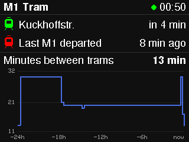
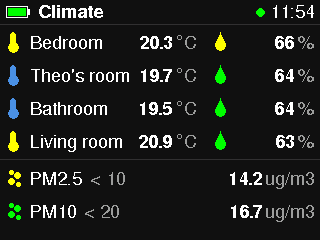
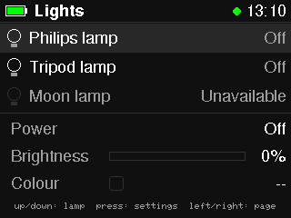
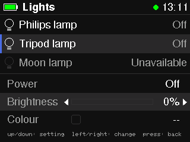
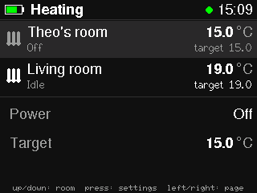
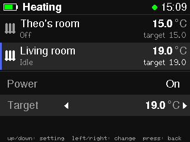
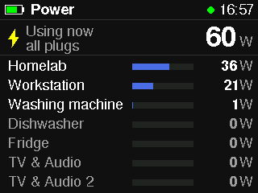
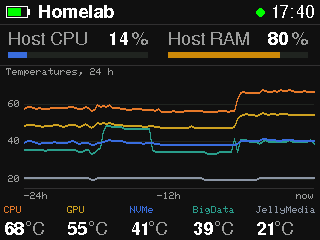
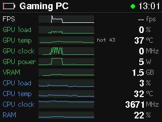

# Wio Terminal Home Assistant controller

A Seeed Wio Terminal that shows Home Assistant dashboards. Joystick
left/right switches pages. A battery meter sits in the top-left corner when
the battery chassis is attached. Backlight runs at 18 %.

**Tram**: when the next M1 leaves Kuckhoffstr. (green tram), when the last
one left (red tram), and a 24 h chart of the minutes between trams.



**Climate**: temperature and humidity per room, then air quality, with the
Control Panel dashboard's colour rules:

| Room | Temperature | Humidity |
|---|---|---|
| Bedroom | `sensor.multi_sensor_bedzimmer` | `sensor.multi_sensor_bedzimmer_2` |
| Theo's room | `sensor.babyroom` | `sensor.babyroom_2` |
| Bathroom | `sensor.temperature_9` | `sensor.humidity_10` |
| Living room | `sensor.living_room` | `sensor.living_room_2` |

- Thermometer: blue below 20 °C, yellow 20–26 °C, red above 26 °C.
- Droplet: green up to 65 %, yellow above 65 %, red above 75 %.
- PM2.5 (`sensor.nova_pm2_5`, limit 10) and PM10 (`sensor.nova_pm10`,
  limit 20): green below the limit, yellow up to twice it, red above.
- Grey icon and `--`: sensor unavailable.



**Lights**: Philips lamp (`light.philips_lamp`), Tripod lamp
(`light.extended_color_light_10`) and Moon lamp (`light.extended_color_light_8`),
controlled directly with `light.toggle` / `light.turn_on` (the dashboard's
brightness slider helpers don't follow these changes).

- Joystick up/down picks a lamp; press opens its settings.
- In the settings, up/down picks Power, Brightness or Colour and left/right
  changes it: toggle, 10 % steps (down to 1 %), or the next colour preset
  (warm white, neutral, cool white, red, orange, yellow, green, cyan, blue,
  purple, pink). Press or B goes back. Left/right switch pages only from
  the lamp list.
- The screen updates on the key press; Home Assistant's state push then
  confirms or corrects it. Nothing is sent while disconnected.

 

**Heating**: Theo's room (`climate.thermostat_14`) and Living room
(`climate.thermostat_15`): current temperature, target, and whether it is
heating (orange radiator). Same keys as Lights: up/down picks a room, press
opens its settings; Power switches between heat and off (auto counts as on),
Target changes in 0.5 °C steps within the thermostat's range (7–35 °C). The
target is sent 1 s after the last press, so a run of presses makes one call.

 

**Power**: "Using now · all plugs" (`sensor.home_plugs_total_power`) from
the Power dashboard, then each plug in watts with a bar for its share of the
total: Homelab (`sensor.power_23`), Workstation (`sensor.wiz_socket_power`),
Washing machine (`sensor.wasching_machine_plug`), Dishwasher
(`sensor.power_36`), Fridge (`sensor.power_27`), TV & Audio
(`sensor.power_30`), TV & Audio 2 (`sensor.power_32`). Plugs under 1 W are
greyed out.



**Homelab**: Proxmox host CPU (`sensor.proxmox_cpu_usage`) and RAM
(`sensor.proxmox_ram_usage`), bars blue / amber from 75 % / red from 90 % as
on the dashboard; then the "Temperatures, last 24 hours" chart: CPU, GPU,
NVMe, BigData, JellyMedia (`sensor.*_temp`) in the card's colours, 15-minute
means, with the current values below. These sensors have no long-term
statistics and a day of raw history is ~100 KB for CPU alone (the websocket
buffer is 24 KB), so after each connect the Wio loads the day in 60 pieces
(2 h × 5 sensors, newest first, about a minute in all) and averages them
itself; live changes extend the chart after that.



**Gaming PC**: MSI Afterburner style, from the Gaming PC dashboard (the PC's
`sensor.desktop_a498ue6_*` sensors, every ~10 s). One row per metric with a
15 min graph and the current value: FPS (fullscreen only, "--" otherwise),
GPU load / temperature (with hot spot) / clock / power / VRAM (green), CPU
load / temperature / clock and RAM (blue). Warning colours follow the
dashboard's chips: CPU above 75 / 85 °C, GPU hot spot above 90 / 100 °C,
RAM above 75 / 90 %, FPS below 60 / 30. The 15 min load per sensor after
each connect (a few KB each). When the sensors are unavailable or nothing
changed for 3 min, the page shows "PC offline" and when it was last seen.



Planned pages: Plugs, Status. Graphs are deferred.

## Buttons

- **C** (leftmost top button): display off / on (18 % brightness). The connection stays up while dark.
- **A**, **B**, joystick: wake the display when it is off.

## Setup

1. Copy `firmware/m1_tram/secrets.h.example` to `firmware/m1_tram/secrets.h`
   and fill in WiFi and a Home Assistant long-lived access token
   (Profile → Security). `secrets.h` and `.env` are gitignored.
2. Libraries (Arduino library folder): `ArduinoJson` 7.x, `Seeed Arduino rpcWiFi`,
   `Seeed Arduino rpcUnified`, `SparkFun BQ27441 LiPo Fuel Gauge`. The display uses the Seeed SAMD core's bundled `TFT_eSPI`.
3. The RTL8720 WiFi chip needs Seeed's eRPC firmware (tested with 2.1.3).

```sh
arduino-cli compile --fqbn Seeeduino:samd:seeed_wio_terminal firmware/m1_tram
arduino-cli upload  --fqbn Seeeduino:samd:seeed_wio_terminal -p /dev/cu.usbmodem14101 firmware/m1_tram
```

Host-side unit tests (time parsing, HA message handling, chart math, WiFi AP
choice, websocket framing):

```sh
test/run.sh
```

## How it works

- One websocket to `ws://<HA_HOST>:8123/api/websocket`: `subscribe_entities`
  for the tram, climate, light and thermostat entities (live pushes),
  `call_service` for the lamps and thermostats, `history/history_during_period`
  for the chart every 10 min, a ping every 30 s.
- If the token is rejected, the device stops and shows "Token rejected" —
  no retries, because Home Assistant bans IPs after repeated failed logins.
  Network drops reconnect with backoff (5 s doubling to 5 min).
- WiFi: the home SSID has a 5 GHz AP whose security the RTL8720 doesn't
  support (a plain `WiFi.begin()` hangs there), so the firmware scans and
  joins the strongest WPA/WPA2 AP by BSSID (`wifi_pick.h`).

## Watchdog

If the main loop stalls for 8 s, the watchdog's early-warning interrupt holds
the RTL8720 WiFi chip in reset, and at 16 s the board resets. This catches the
rpcWiFi connect that hangs for minutes when the HA host is down. The WiFi chip
needs the long reset: after a short one its scans came back empty and hung.
The last step reached before a reset is kept in backup RAM and printed at boot.

## Serial commands (115200 baud)

- `r`: drop and reconnect the Home Assistant session (tests recovery).
- `p`: next page (like joystick right).
- `U` `D` `L` `R` `P`: joystick up/down/left/right/press, `B`: button B.
  On the Lights and Heating settings, `L`/`R` change real devices.
- `s`: dump a screenshot: `SHOT\n` followed by 320×240 RGB565 pixels, big-endian.
- `c`: uptime, HA status, watchdog early-warning count.
- `w`: hang on purpose to test the watchdog.

Opening and closing the serial port repeatedly while the board is running can
make an rpcWiFi call hang (then the watchdog resets it). Keep one monitor open,
or check resets passively by watching whether `/dev/cu.usbmodem*` disappears.

## Files

| File | Role |
|---|---|
| `m1_tram.ino` | setup/loop, page table |
| `net.h` | WiFi with backoff, NTP clock |
| `wifi_pick.h` | which AP to join (pure) |
| `ws_client.h`, `ws_frame.h` | minimal websocket client (ArduinoWebsockets has no SAMD support) |
| `ha.h`, `ha_proto.h` | HA session I/O, protocol handling (pure) |
| `tram_model.h`, `climate_model.h` | HA messages → page state, colour rules (pure) |
| `timeutil.h` | ISO time parsing, Berlin time, "in 4 min" / "3 min ago" (pure) |
| `header.h` | shared header: battery, title, HA status, clock; colours |
| `page_tram.h`, `chart.h` | tram page drawing, chart geometry (pure) |
| `page_climate.h` | climate page drawing |
| `lights_model.h`, `page_lights.h` | lamp state, keys, service calls (pure); lights page drawing |
| `heating_model.h`, `page_heating.h` | thermostat state, keys, debounced target (pure); heating page drawing |
| `power_model.h`, `page_power.h` | plug power readings, bar share (pure); power page drawing |
| `homelab_model.h`, `page_homelab.h` | host usage, 24 h temperature buckets and history loading (pure); homelab page drawing |
| `gaming_model.h`, `page_gaming.h` | gaming PC metrics, 15 min graph buckets, warning colours, offline detection (pure); gaming PC page drawing |
| `ui.h`, `sleep_ctl.h` | buttons, display sleep, page switching |
| `backlight.h` | PWM brightness via TC0 → CCL → EVSYS (the pin has no PWM) |
| `battery.h`, `battery_meter.h` | BQ27441 fuel gauge, meter math (pure) |
| `wdt.h` | watchdog, WiFi chip reset on early warning, breadcrumbs |

Design: `docs/superpowers/specs/2026-11-01-tram-page-design.md`.
Plan: `docs/superpowers/plans/2026-11-01-tram-page.md`.
